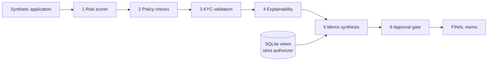

# Finance Credit Memo — Multi-Agent Underwriting (Synthetic Data)

> **Recruiter summary.** A six-agent pipeline that turns a synthetic loan
> application into a structured, human-readable credit memo: a
> deterministic risk scorer, policy checks against a cited synthetic
> rulebook, KYC validation, exact per-feature explanations, memo
> synthesis, and a named-person approval gate before anything is final.
> Proof: 90 tests, all passing on the standard library alone, including
> runtime denial proofs for the database authorizer and one test per
> approval-gate failure mode. Every number below comes from an actual
> run in this repo; the five sample applications are regression
> fixtures, not evidence about real borrowers.

## What this is

Underwriting a loan means answering four questions in order: how risky
is this borrower, does the deal fit policy, is the identity verified,
and can the reasoning be shown to a reviewer? This repo answers all
four with collaborating agents, then synthesises a memo a human can
read, challenge, and approve. The fictional lender is **Tarnfield
Community Credit Union** — an invented firm. All loan data is
**synthetic, always**. This is an independent project; it is not
affiliated with any university, training provider, or real lender, and
it is not a lending decision engine.

## Architecture



Detail: [docs/architecture.md](docs/architecture.md) and
[knowledge/architecture.md](knowledge/architecture.md).

## How it works, step by step

1. **Risk classification.** A deterministic scorer maps six inputs
   (credit score, debt-to-income, loan-to-value, recent delinquencies,
   employment length, reserves) to points. Score = base 300 + the sum
   of the six contributions, then a band: A (≥750), B (650–749),
   C (550–649), D (<550).
2. **Policy compliance.** Six rules from the synthetic rulebook
   ([docs/policy-rulebook.md](docs/policy-rulebook.md)) are checked;
   each result carries its rule id and section.
3. **KYC validation.** Four boolean checks: ID on file, name match,
   address verified, sanctions screen clear. Any failure blocks.
4. **Explainability.** The scorer's contributions are carried into the
   memo verbatim, so the memo shows exactly why the score is what it
   is — the contributions sum to score minus base, proved by test.
5. **Memo synthesis.** A structured memo with recommendation,
   contribution table, policy table, KYC outcome, conditions, and
   rationales that cite rulebook sections. PII is redacted as a final
   sweep, and the builder never reads PII fields at all.
6. **Approval gate.** A named person redeems a single-use, scoped,
   expiring token with an unambiguous, high-confidence "yes". Without
   it, the memo stays DRAFT. Bypass, reject, absent, low-confidence,
   and self-contradicting ("yes, wait, no") consents are each rejected
   by their own test.

Full walkthrough: [docs/how-it-works.md](docs/how-it-works.md).

## Real code, real output

```python
from credit_memo.pipeline import run_pipeline
from credit_memo.samples import CLEAN_KYC, SAMPLES

result = run_pipeline(SAMPLES[0], CLEAN_KYC, "MEMO-APP-2026-001")
memo = result["memo"]
print(memo.recommendation, memo.risk_band, memo.score)
```

```
Approve A - Low risk 960
```

Demo over all five synthetic samples (`python3 examples/run_demo.py`):

```
== APP-2026-001: Approve (band A - Low risk, score 960)
   credit_score: +250
   debt_to_income: +150
   delinquencies_24m: +80
   employment_years: +60
   loan_to_value: +60
   reserves_months: +60
   sum check: 300 + 660 = 960
   policy: 6/6 rules met, KYC PASS
== APP-2026-005: Decline (band A - Low risk, score 780)
   policy: 5/6 rules met, KYC PASS
== MEMO-FINAL-DEMO: status FINAL, approved by Priya Nair
```

Note APP-2026-005: a strong score does not override a hard policy
breach (loan amount above the synthetic cap), so the recommendation is
Decline. That override is deliberate and tested.

## How to run (offline first)

```bash
python3 -m pytest tests/ -q        # full suite, stdlib only
python3 examples/run_demo.py       # five synthetic memos + one approval
python3 tools/brand_check.py .     # no real-firm names in shipped files
```

No dependencies, no network, no credentials, no database server. The
store is an in-memory SQLite database; see
[docs/implementation-guide.md](docs/implementation-guide.md) for
adopters. There is no deployment target, no package release, and no
CI badge in this scaffold — CI configuration is added at push time by
convention, not shipped here.

## Guardrails and security controls

- **View-aware SQLite authorizer.** Base-table reads are allowed only
  when the authorizer's source argument names an allowed view; direct
  base-table reads, `sqlite_master`, all writes, PRAGMA, ATTACH, and
  extension loading are denied — each proved at runtime by a test.
  Authorizer tests run with the text check disabled: they contain
  probe strings by necessity, and the proof is the raised error, not
  text matching (see the header of `tests/test_authorizer.py`).
- **Approval gate.** Named-person, single-use, scoped, expiring, with
  low-confidence and self-contradicting-consent rejection.
- **PII redaction.** Card numbers and email addresses are redacted
  alongside phone numbers and SSNs, in memos, log lines, and errors.
- **Row cap.** Fetches use `fetchmany(MAX+1)` and fail loudly on
  overflow; queries are never rewritten with LIMIT.
- **Cost guards.** Negative, NaN, boolean, or infinite cost inputs
  are rejected.
- **Brand guard.** Real-firm names are blocklisted as hashes, never
  plain text; the blocklist is asserted non-empty by a test.
- **Email.** Dry-run by default, explicit opt-in to send, refused in
  CI, no transport and no credentials in this repo.

Detail: [docs/guardrails.md](docs/guardrails.md),
[docs/threat-model.md](docs/threat-model.md).

## Limitations and known failures (kept visible)

- The scorer is a transparent rule table, not a trained model: it
  cannot learn, and its bands are illustrative, not calibrated.
- The synthesis layer uses deterministic templates, not a language
  model: memos are consistent but formulaic.
- The store is read-only after seeding: there is no writer service,
  so finalised memos are not persisted to SQLite in this scaffold.
- KYC evidence is boolean flags, not document verification.
- Sample size is 5 synthetic applications: enough for regression
  checks, not for any quality claim.

Full list: [docs/limitations.md](docs/limitations.md).

## Built vs planned

| Item | Status |
| --- | --- |
| Risk scorer, policy checks, KYC, explainability, memo synthesis, approval gate | Built, tested |
| View-aware SQLite authorizer, redaction, row cap, budget, brand, email guards | Built, tested |
| README + docs/ checklist, knowledge/ notes, demo, brand/overlap tools | Built, run |
| CI workflow, badges, deployment, package release | Planned — not claimed |
| Language-model memo narration, persistent memo writer, web UI | Planned |
| Written-not-run items | None — every shipped script was executed during scaffolding |

## Docs

- [docs/architecture.md](docs/architecture.md) — architecture + data flow
- [docs/how-it-works.md](docs/how-it-works.md) — step-by-step run
- [docs/guardrails.md](docs/guardrails.md) — controls and their proofs
- [docs/limitations.md](docs/limitations.md) — limits and known failures
- [docs/implementation-guide.md](docs/implementation-guide.md) — adopter guide
- [docs/interview-points.md](docs/interview-points.md) — talking points
- [docs/threat-model.md](docs/threat-model.md) — STRIDE + ADRs
- [docs/adr.md](docs/adr.md) — architecture decision records
- [docs/policy-rulebook.md](docs/policy-rulebook.md) — synthetic rulebook
- [docs/related-repos.md](docs/related-repos.md) — neighbouring repos
- [knowledge/notes.md](knowledge/notes.md) — distilled patterns
- [knowledge/architecture.md](knowledge/architecture.md) — Mermaid diagrams

## Source note

Patterns in this repo were distilled in the author's own words from a
published program brochure on AI in finance. No brochure sentences are
reproduced: an 8-word overlap check of all repo docs against the
extracted brochure text returned **0 hits** (run 2026-10-26;
`tools/overlap_check.py` takes the source text as an argument, and the
source itself is never committed here). The brochure's case material
uses real loan data; this repo deliberately uses synthetic data only.
