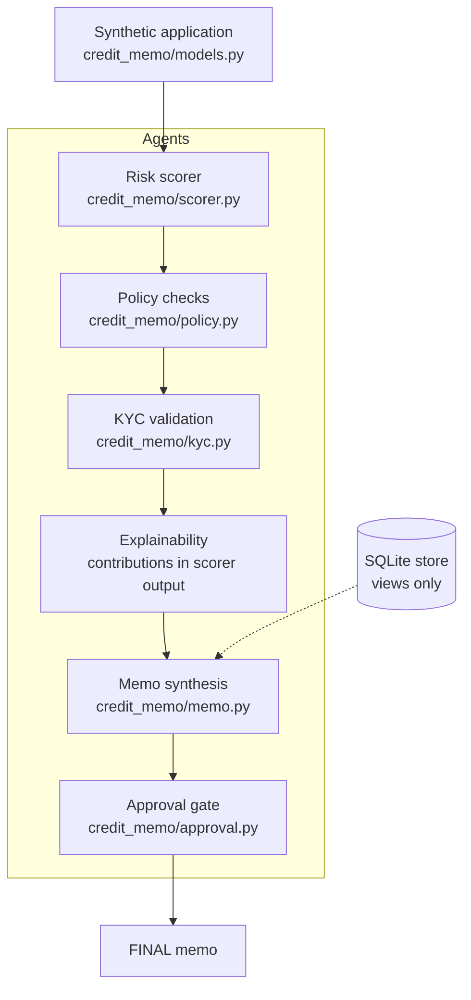

# Architecture

## Components

## Data flow

1. An `Application` carries numeric underwriting fields. PII fields
   exist on the model only as redaction/view test fixtures; the memo
   builder never reads them.
2. The scorer returns a `RiskResult`: score, band, base, and the six
   per-feature contributions. The identity
   `score == base + sum(contributions)` holds exactly (integer
   arithmetic, no rounding, no clamping).
3. Policy checks return one `PolicyResult` per rule, each citing its
   rulebook section. Severity separates hard failures (which force
   Decline) from compensating failures (which force Refer).
4. KYC returns PASS/FAIL plus a blocker list. Any blocker forces
   Decline at recommendation time.
5. The memo builder assembles the structured memo and redacts the
   finished text as a final sweep.
6. The approval gate is the only path from DRAFT to FINAL. It checks
   person, token use, scope, expiry, and consent quality, in that
   order, and raises a distinct error for each failure.

## Store

`credit_memo/store.py` seeds two base tables (`applications`,
`memos`) and two views (`v_application_metrics`, `v_memo_status`),
then installs the authorizer. After installation the connection can
only read through the views. Views expose no `borrower_*` columns, so
even a legitimate view read cannot return PII. Writes are denied
outright: this scaffold has no writer service, and that gap is
recorded in [limitations.md](limitations.md) rather than papered over.
